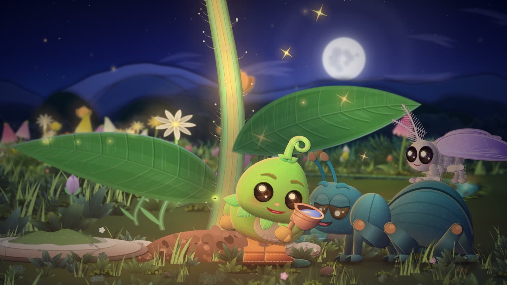
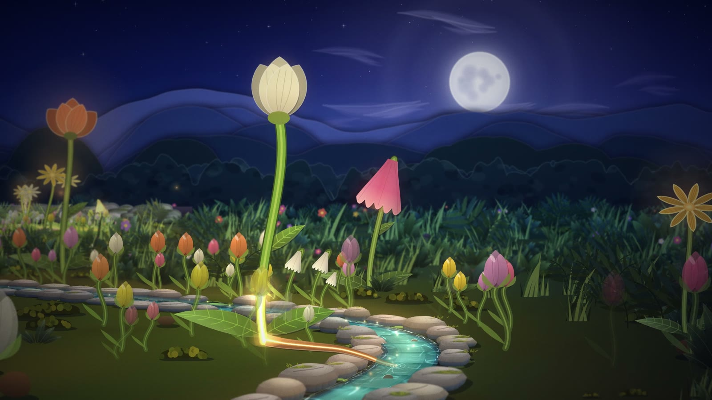
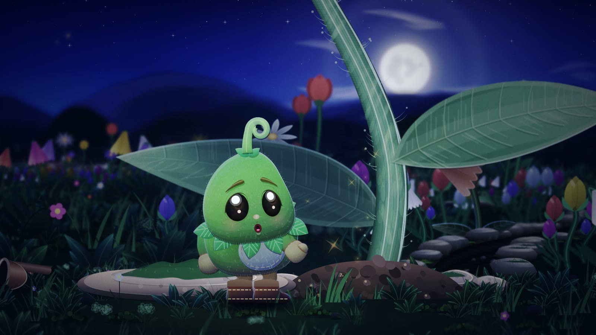
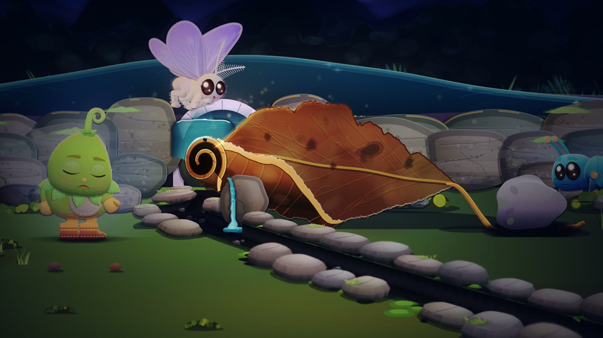
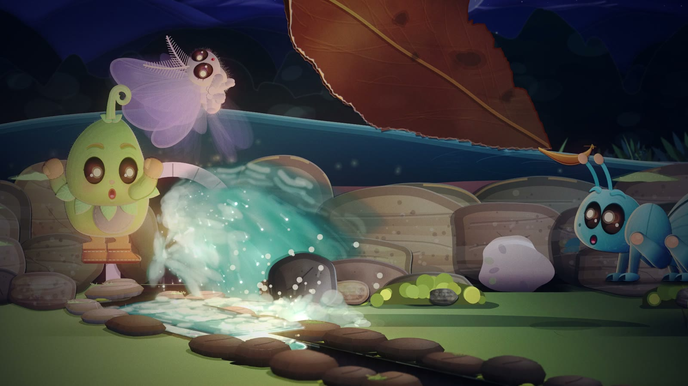

<p align="center"><strong>KIDS STORY STUDIO</strong><br>An animated short, drawn entirely by code.</p>



<sub>An actual frame from the film. Every pixel is drawn by the JavaScript in <code>film/</code>: no images, no 3D
engine, no AI-generated pictures.</sub>

# Pip and the Missing Glow

A 135-second paper-cut animation for children. In Pip's garden, water carries light: every evening it runs down a
stone channel and each flower glows as it passes. One night the channel runs dry and Pip's flower goes dark. He and
two new friends follow the channel upstream to find out why, and learn that some things are easier together.

This repository is the whole film as about 10,000 lines of plain JavaScript on a 2D canvas, a soundtrack mixer with
code-made foley (plus notes on scoring and narrating it with open local models), and guides to **how it was made: by
directing AI coding agents** the way a small studio directs its departments.

**[Build a film with AI agents](guides/building-with-agents.md) · [The renderer](guides/paper-cut-renderer.md) ·
[Sound](guides/sound.md) · [Prompts](prompts/) · [MIT license](LICENSE)**

| | |
| --- | --- |
|  |  |
|  |  |

## Quick start

Needs Node.js 20+, and FFmpeg with libx264 for the full film.

```bash
npm install
npx playwright install chromium        # once, if you don't already have it
python3 -m http.server 8000 -d film
```

Open `http://localhost:8000/comp.html?play` to play the film in the browser, or `comp.html?t=68` for a single frame.
If you serve with `npx serve film` instead, drop the `.html` (`http://localhost:3000/comp?play`): `serve` redirects
`comp.html?play` to `/comp` and loses the query, and you get a black page.

Render stills, a contact sheet, then the full picture (the picture needs FFmpeg):

```bash
node film/render.mjs --stills 8,23,68,101,121 --still-dir out/stills
node film/render.mjs --stills 0:135:4.5 --still-dir out/sheet --sheet 6x5     # every 4.5 s, tiled into out/sheet/sheet-01.png
node film/render.mjs --out out/picture.mp4            # 4,050 frames at 1920x1080, 30 fps
```

Most frames take about half a second: `render.mjs` uses Chromium's software canvas so every frame comes out
identical. The burst's frames are the slow ones (up to 9 s each), because they stack many depth-of-field layers. On
an Apple-silicon Mac the full film took 55 minutes, 0.82 s a frame on average. `npm test`
checks that the drawing code never reads randomness or the clock, and that the shot table in `CONTRACT.md` and the cue
sheet still agree with `shots.js`.

## How it works

```
film time T ──► shots.js: story state (how far the water has run, which flowers are lit, how curled the leaf is)
            ──► act1/2/3.js: the shot at T (camera, who stands where, poses, effects, extra lights)
            ──► world.js + cast.js + fx.js: cards at depth (garden, puppets, water, glow)
            ──► core.js: project, sort, light, blur by depth, grade ──► one 1920x1080 frame
```

| File | What it holds |
| --- | --- |
| [`film/CONTRACT.md`](film/CONTRACT.md) | Units, geography, the shared state, every module's API, and the staging bible (story, shot table, framing rules) |
| [`film/core.js`](film/core.js) | The renderer: pinhole camera, paper cards, lighting, depth of field, bloom, vignette, grain |
| [`film/world.js`](film/world.js) | The garden: sky, moon, paper hills, ground, the cobble channel, flowers, Pip's flower, the stone spout |
| [`film/cast.js`](film/cast.js) | Pip, Bram and Luma as rigged cut-out puppets: pose fields, IK arms, walk and run cycles with planted feet, smooth faces |
| [`film/fx.js`](film/fx.js) | Water that carries light, the burst, glow lights, motes, fireflies, puffs and splashes |
| [`film/shots.js`](film/shots.js), `act1-3.js` | The story as a function of time, and the 21 shots |
| [`film/render.mjs`](film/render.mjs) | Headless Chromium to PNG to FFmpeg; stills, contact sheets, labs or the full film |
| [`film/qa.mjs`](film/qa.mjs) | Measures a rendered cut shot by shot (brightness, colour, contrast, frozen frames, jolts) against the targets in the contract: `npm run qa` |
| [`film/comp.html`](film/comp.html), [`film/lab.html`](film/lab.html) | The pages that load the modules: the film, and the lab host |
| [`film/sound/`](film/sound/) | Procedural foley, cue sheet and the mixer (stems, loudness, captions) |
| `film/lab-world.js`, `lab-cast.js`, `lab-fx.js` | Lab scenes for checking one module on its own |

The rule that holds it together: **every frame is a pure function of time**. No randomness, no clock, no memory of
the previous frame. Any frame can be rendered alone, checked, changed and checked again in seconds, which is what lets
an AI agent review its own work by looking at it.

## Made by

This sample was made by the team behind **[ProcVideos](https://procvideos.com/)** (videos made with code),
**[Attain OS](https://attainos.com/)** and **[AttainSoft](https://attainsoft.co/)**. If you want to go further, see
[optional next steps](guides/related-tools.md). None of them is needed to use anything here.

## License

Code and documentation are MIT licensed ([LICENSE](LICENSE)). Third-party tools and models keep their own terms.
